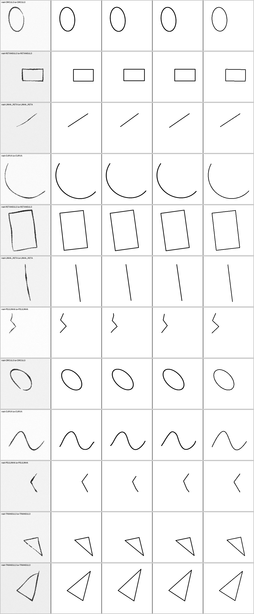
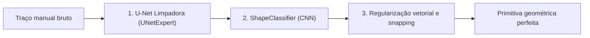
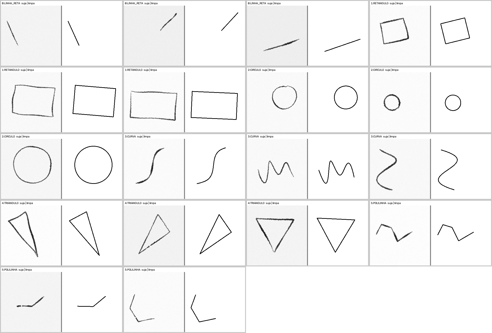

# 🎨 Haline Andante — Hybrid Vectorizer & Geometric Stroke Corrector

Pipeline de Inteligência Artificial para limpeza, classificação e regularização geométrica de traços de desenho manual em tempo real.



---

## 📌 Visão Geral

O projeto converte esboços manuais (*dirty sketches*) — com tremor, variação de pressão e imprecisão — em **primitivas vetoriais perfeitas**, com conectividade contextual (*snapping*).

O pipeline opera em 3 estágios:



1. **U-Net Limpadora (`UNetExpert`)**: recebe o rascunho com ruído e devolve uma máscara limpa e fina do traço.
2. **Classificador de Formas (`ShapeClassifier`)**: identifica a classe da primitiva desenhada.
3. **Regularização Geométrica & Snapping**: ajusta a geometria exata aos pontos originais e conecta o novo gesto às formas já desenhadas no canvas.

### Primitivas suportadas

| ID | Classe | Ajuste geométrico |
| :--- | :--- | :--- |
| 0 | `LINHA_RETA` | Reta por regressão robusta (Huber) |
| 1 | `RETANGULO` | Quadrilátero fechado por retas robustas |
| 2 | `CIRCULO` | Elipse/círculo por mínimos quadrados |
| 3 | `CURVA` | B-Spline suavizada (`scipy.interpolate`) |
| 4 | `TRIANGULO` | Triângulo a partir do casco convexo, com lado outlier descartado |
| 5 | `POLILINHA` | Cadeia de segmentos com vértices nos cantos reais do traço |

O terceiro estágio também faz **snapping de contexto** (raio de 8 px): vértices e extremidades do novo traço aderem primeiro a vértices já existentes e depois à projeção sobre um segmento existente — o comportamento que um artista espera ao "fechar" um desenho.

---

## 📂 Estrutura do Repositório

```text
├── assets/                           # Imagens de preview
│   ├── dataset_preview.png           # Amostras do dataset gerado
│   └── eval_preview.png              # Visualização ponta a ponta da IA
├── logs/
│   └── eval_log.txt                  # Métricas e matriz de confusão da última validação
├── models/                           # Checkpoints treinados (.pt)
│   ├── cleaner_model.pt              # Pesos do UNetExpert (~4,9 MB)
│   └── classifier_model.pt           # Pesos do ShapeClassifier (~1,9 MB)
├── src/                              # Código-fonte
│   ├── __init__.py                   # Pacote Python
│   ├── hybrid_vectorizer.py          # Arquitetura das redes + ajuste geométrico + snapping
│   ├── train_hybrid.py               # Treinamento supervisionado e avaliação A/B/C
│   ├── dataset_generator_hybrid.py   # Gerador de dataset sintético realista
│   ├── canvas_hybrid.py              # App interativo Tkinter para desenho ao vivo
│   ├── model_analyzer.py             # Relatório de arquitetura e diagnóstico de forward
│   └── moe_model.py                  # Arquitetura experimental MoE (legado, não usada)
├── .gitignore
├── README.md
└── requirements.txt
```

---

## 🚀 Instalação

### 1. Clonar o repositório
```bash
git clone https://github.com/SEU_USUARIO/Haline-Andante.git
cd Haline-Andante
```

### 2. Ambiente virtual e dependências
```bash
python -m venv .venv

# Ativar no Windows (PowerShell):
.venv\Scripts\Activate.ps1
# Ou no Linux/macOS:
# source .venv/bin/activate

pip install --upgrade pip
pip install -r requirements.txt
```

> Os checkpoints em `models/` são a build **CPU**. Em máquina com CUDA, `train_hybrid.py` e `HybridShapeCorrector` detectam a GPU automaticamente.

---

## 🎮 Como Usar

### 1. Canvas interativo (desenho em tempo real)
```bash
python src/canvas_hybrid.py
```
> O app carrega os pesos de `models/` automaticamente. Sem checkpoint, cai no *fallback* de heurísticas OpenCV, que é bem menos preciso.

### 2. Usar como biblioteca
```python
import cv2
from src.hybrid_vectorizer import HybridShapeCorrector, render_scene, snap_primitive

corrector = HybridShapeCorrector("models/cleaner_model.pt", "models/classifier_model.pt")
scene = []

for sketch in strokes:                       # uma imagem 256x256 por traço
    primitive, shape_name = corrector.process_vector(sketch)
    if primitive is None:                    # traço sem primitiva confiável
        continue
    scene.append(snap_primitive(primitive, scene))

cv2.imwrite("saida.png", render_scene(scene))
```

Para corrigir um único traço sem cena, obtendo só a imagem:
```python
corrected, shape_name = corrector.process(sketch)
```

### 3. Gerar dataset sintético
Gera pares suja/limpa com imperfeições realistas de desenho (B-Splines, oscilação de alta frequência, variação de pressão e lacunas de levante de caneta):
```bash
python src/dataset_generator_hybrid.py --samples-per-class 1000 --seed 42
```
*Saída padrão em `dataset_artist_v2/`, com preview em `preview.png`.*



### 4. Treinar as redes
Treina **UNetExpert** e **ShapeClassifier** simultaneamente:
```bash
python src/train_hybrid.py --epochs 25 --batch-size 16 --data dataset_artist_v2 --out-dir models
```

Para apenas reavaliar checkpoints existentes:
```bash
python src/train_hybrid.py --eval-only --data dataset_artist_v2 --out-dir models
```

### 5. Analisar a arquitetura
```bash
python src/model_analyzer.py          # relatório em texto
python src/model_analyzer.py --json   # saída em JSON
```

---

## 📊 Resultados e Métricas

Validação em **300 amostras** (50 por classe) que nunca participaram do treino.

| Métrica | Resultado |
| :--- | :--- |
| **Acurácia de classificação** | **100.0%** (300/300, matriz de confusão totalmente diagonal) |
| **Distância média (Chamfer, IA × alvo ideal)** | **0.75 px** |
| **Amostras com erro ≤ 1.5 px** | **88.7%** |
| **Parâmetros totais do pipeline** | **1.691.943** (1.221.201 U-Net + 470.742 classificador) |

### Desempenho por primitiva (pipeline completo)

| Classe | Média | p90 | ≤ 1.5 px |
| :--- | ---: | ---: | ---: |
| `LINHA_RETA` | 0.71 px | 1.60 px | 88.0% |
| `RETANGULO` | 0.63 px | 1.32 px | 94.0% |
| `CIRCULO` | 0.55 px | 1.06 px | 98.0% |
| `CURVA` | 0.85 px | 1.56 px | 86.0% |
| `TRIANGULO` | 0.58 px | 1.00 px | 96.0% |
| `POLILINHA` | 1.17 px | 2.02 px | 70.0% |

### Como a avaliação é medida

O script reporta três níveis, para separar o mérito de cada estágio:

- **A_ALVO** — ajuste geométrico aplicado sobre o alvo ideal. É o teto do ajustador: **0.16 px** de média.
- **B_OTSU** — binarização por Otsu no lugar da U-Net, ou seja, o que se consegue sem rede: **0.93 px**.
- **C_REDE** — pipeline completo: **0.75 px**.

A U-Net contribui com 0.18 px de melhoria no geral, concentrada em `POLILINHA` (2.08 → 1.17 px), onde o limiar não fecha as lacunas deixadas pelo levante de caneta.

### Limitações conhecidas

- `POLILINHA` é o ponto fraco: em traços com lacuna, o ajustador às vezes cria um vértice extra.
- As métricas vêm de **dataset sintético**. Traços reais de mesa digitalizadora podem ter pressão e inclinação fora dessa distribuição.
- O *fallback* sem checkpoint confunde círculo com retângulo e reta com curva; use os pesos.

---

## 🛡️ Licença

Este projeto está sob licença MIT. Sinta-se livre para usar, modificar e distribuir.
